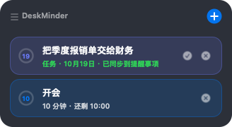

# DeskTask

[English](README.md) · [简体中文](README.zh-CN.md)

A tiny macOS desktop reminder widget, written from scratch in Swift + AppKit.



## What it does

| | |
| --- | --- |
| **Pull to set a timer** | Grab the rubber band and stretch it — the further you pull, the longer the countdown. Let go and it starts, no typing required. |
| **Tasks go into Apple Reminders** | Pick a date (today / tomorrow / the day after / any date), type the task, and it is created in the Reminders app with that due date. |
| **Stays out of the way** | When idle it collapses into a 296×26 status strip — nearest countdown plus today's task count — or a 42pt glass dot when nothing is running, parked on the desktop behind every normal window. |


Click the `+` and you get two ways in, plus a row of quick timers:

```
┌──────────────────────────────────┐
│ ⠿ DeskTask                  ⊖    │
│ [Pull a timer] [Pick a date]     │
│ [5m] [10m] [25m] [30m] [60m]     │
└──────────────────────────────────┘
```

Task cards have **✓ = mark complete in Reminders and remove** and **✕ = remove from the desktop only**.
Timer cards show a ring that fills as the countdown runs. When it hits zero the app plays the
system *Glass* sound, floats the window to the front, and repeats every 30s (up to 5 times) —
and then **removes the card two minutes later**, so nothing red is left lying around.

A **收起 (collapse)** button in the header folds it back into the strip at any time — the
collapse is automatic as well, but you do not have to wait for it.

**Overdue tasks stay put.** A task whose due date has passed is kept in the list, marked red as
overdue instead of silently lingering, and the idle strip switches to reporting how many tasks are
overdue.

## Quick start

Only the **Command Line Tools** are required — no Xcode, no dependencies, no package manager.

```bash
git clone https://github.com/KyoWuJiuJiu/DeskTask.git
cd DeskTask
./run.sh          # build and restart
```

To install it like a real app:

```bash
./install.sh             # copy into /Applications + start at login
./install.sh --no-login  # copy only
./install.sh --uninstall # remove both
```

`./run.sh` rebuilds, stops the previous instance, and relaunches — always use it instead of `open`,
because `open` on an already-running bundle only *activates* the old process (running the old code)
and looks like nothing happened.

The first time you create a task, macOS asks whether DeskTask may control **Reminders**. Say yes.

## Where it sits

The window does not follow the mouse. It is pinned to **screen centre, just below the notch**
(using `NSScreen.safeAreaInsets.top`, falling back to the menu bar height), and the anchor is the
top *centre* so it stays centred as its width changes.

Window level follows the state:

| State | Level | Meaning |
| --- | --- | --- |
| Idle (dot / strip) | `kCGDesktopIconWindowLevel + 3` | on the desktop: above the wallpaper, desktop icons and the Notification Centre panel, below every level-0 window |
| Expanded (panel open) | `.floating` | on top, so you can operate it |

## Gotchas

These cost real debugging time; the comments in the source explain each one.

1. **Never write `stringValue` on a text field that is being edited.** The UI ticks at 4 Hz; writing
   the model back into the field mid-composition resets the IME's marked text, so Chinese input
   commits one character at a time and can never be finished. `ChipView` writes it once, at creation.
2. **SwiftUI is not usable here.** In current SDKs `@State` / `@Binding` / `@ObservedObject` are
   macros whose implementation ships inside Xcode; with only the Command Line Tools they fail to
   expand. Everything is hand-drawn AppKit instead.
3. **Window levels are load-bearing.** The Finder's desktop window is a *full-screen* window at
   `-2147483603`. Park anything below it and it stays visible (that layer is transparent) but every
   click is swallowed by Finder — the widget looks fine and is dead. Desktop widgets themselves sit
   at level 0, the same as normal windows, so "in front of the widgets" and "behind all windows"
   cannot both be true; this app chooses the latter.
4. **`open` on a running bundle does nothing useful.** See above — use `run.sh`.
5. **LaunchServices keeps records for deleted paths.** After moving or renaming the project folder,
   the launcher keeps showing a grey placeholder icon for the old bundle. Unregister it with
   `lsregister -u <old path>`; clearing icon caches will not help.

## Layout

| Path | What |
| --- | --- |
| `Sources/PullStops.swift` | pull distance → minutes; the damping and stickiness live here |
| `Sources/PullBandView.swift` | the rubber band: mouse handling, drawing, snap-back animation |
| `Sources/PanelViews.swift` | `+` button, pill buttons, the mode row, the idle status strip |
| `Sources/Model.swift` | items, the 4 Hz tick, firing |
| `Sources/ChipView.swift` | reminder cards (timer and task variants) |
| `Sources/RemindersBridge.swift` | `osascript` bridge: create a task, complete one by id |
| `Sources/WidgetView.swift` | panel state machine, layout, adaptive window size |
| `Sources/main.swift` | app entry, window, desktop-shelf level, menu bar item |
| `tools/make-icon/` | the app icon, drawn with CoreGraphics and packed via `iconutil` |
| `tools/render.sh` | renders every UI state to PNG without opening a window |

## License

[MIT](LICENSE).

An independent implementation. The interaction is inspired by
[DeskMinder](https://setapp.com/apps/deskminder) by Softorino; this project is not affiliated with
or endorsed by them, and shares no code with it.
